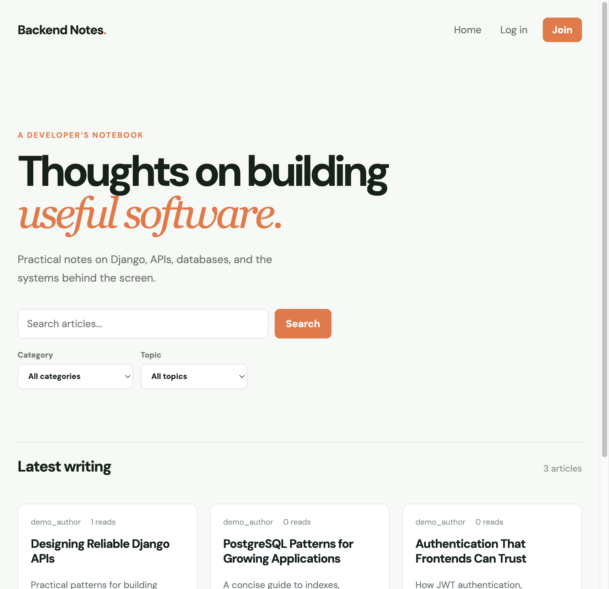

# Django Blog CMS API

A headless Django CMS and REST API for publishing technical articles. It demonstrates authentication, permissions, moderation, search, scheduling, engagement tracking, PostgreSQL, API documentation, structured logging, and frontend-ready API design.

## Frontend preview

The companion Angular client is available in [angular-blog-cms](https://github.com/Pawan2804/angular-blog-cms).



## Features

- Posts with draft, published, scheduled, featured, and archived states
- Tags, categories, profiles, comments, likes, and view counts
- JWT registration, login, and refresh tokens
- Author-only editing and staff-wide management
- Staff comment moderation and private draft previews
- Search, filtering, ordering, pagination, and standardized API errors
- PostgreSQL by default, Docker Compose, CORS, and JSON request logs
- Swagger UI and OpenAPI schema

## Project structure

```text
blog-cms/
├── blog/                 # Django app: models, serializers, views, admin, tests
├── config/               # Django settings and project URLs
├── docker-compose.yml    # Local PostgreSQL service
├── requirements.txt      # Python dependencies
└── manage.py
```

## Requirements

- Python 3.12+
- PostgreSQL 14+
- Docker Desktop recommended for local PostgreSQL

## Backend setup

```bash
python -m venv .venv
source .venv/bin/activate
pip install -r requirements.txt
cp .env.example .env
docker compose up -d db
python manage.py migrate
python manage.py createsuperuser
python manage.py runserver
```

The API runs at `http://127.0.0.1:8000`.

The application uses PostgreSQL by default. Configure it with `POSTGRES_DB`, `POSTGRES_USER`, `POSTGRES_PASSWORD`, `POSTGRES_HOST`, and `POSTGRES_PORT`. Frontend origins are configured with the comma-separated `CORS_ALLOWED_ORIGINS` variable.

For a temporary test run without PostgreSQL:

```bash
USE_SQLITE_FOR_TESTS=1 python manage.py test
```

The current test suite covers authentication, permissions, post visibility, validation, likes, comments, profiles, view counts, logging, and error responses.

## API endpoints

### Public content

| Method | Endpoint | Description |
| --- | --- | --- |
| `GET` | `/api/posts/` | Published post list |
| `GET` | `/api/posts/{slug}/` | Post detail and view count |
| `GET` | `/api/posts/featured/` | Featured published posts |
| `GET` | `/api/tags/` | Tags |
| `GET` | `/api/categories/` | Categories |
| `GET` | `/api/profiles/` | Public profiles |
| `GET` | `/api/comments/?post={id}` | Approved comments |

Post queries support `search`, `ordering`, `page`, `tags__slug`, and `categories__slug`.

### Authentication

| Method | Endpoint | Description |
| --- | --- | --- |
| `POST` | `/api/auth/register/` | Register a user |
| `POST` | `/api/auth/token/` | Obtain access and refresh JWTs |
| `POST` | `/api/auth/token/refresh/` | Refresh an access token |

Protected requests use:

```http
Authorization: Bearer <access-token>
```

### Authenticated actions

| Method | Endpoint | Description |
| --- | --- | --- |
| `POST` | `/api/posts/` | Create a post |
| `PATCH/DELETE` | `/api/posts/{slug}/` | Manage your post |
| `POST/DELETE` | `/api/posts/{slug}/like/` | Like or unlike |
| `GET` | `/api/posts/{slug}/preview/` | Preview your draft |
| `POST` | `/api/comments/` | Submit a comment |
| `PATCH` | `/api/profiles/{id}/` | Update your profile |

### Staff actions

| Method | Endpoint | Description |
| --- | --- | --- |
| `POST` | `/api/comments/{id}/approve/` | Approve a comment |
| `POST` | `/api/comments/{id}/reject/` | Reject a comment |
| `PATCH` | `/api/posts/{slug}/` | Manage any post and feature posts |

## Error response format

All API errors use one shape:

```json
{
  "error": {
    "code": "validation_error",
    "message": "Request validation failed.",
    "details": {"title": ["Title cannot be blank."]}
  }
}
```

## Documentation and admin

- Swagger UI: `http://127.0.0.1:8000/api/docs/`
- OpenAPI schema: `http://127.0.0.1:8000/api/schema/`
- Django admin: `http://127.0.0.1:8000/admin/`

## Testing

```bash
USE_SQLITE_FOR_TESTS=1 python manage.py check
USE_SQLITE_FOR_TESTS=1 python manage.py test
```

## Production checklist

- Set `DEBUG=False`, a strong `SECRET_KEY`, and explicit `ALLOWED_HOSTS`
- Use managed PostgreSQL, HTTPS, backups, and secure proxy settings
- Configure production CORS origins
- Run migrations during deployment
- Ship structured logs to monitoring

## License

This project is intended as a portfolio and learning project.
